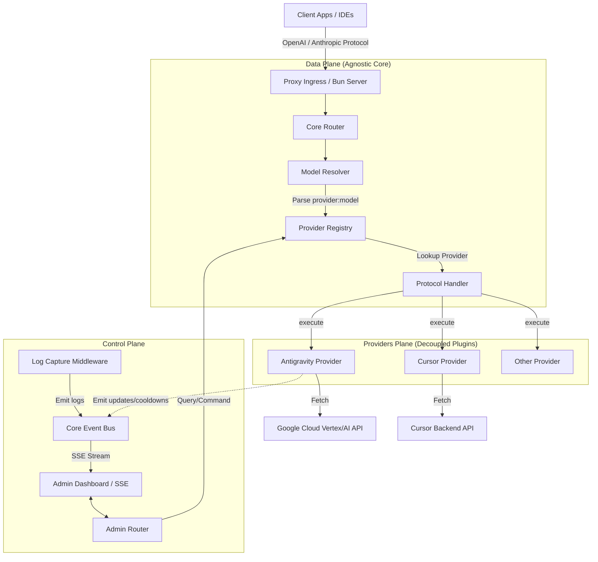
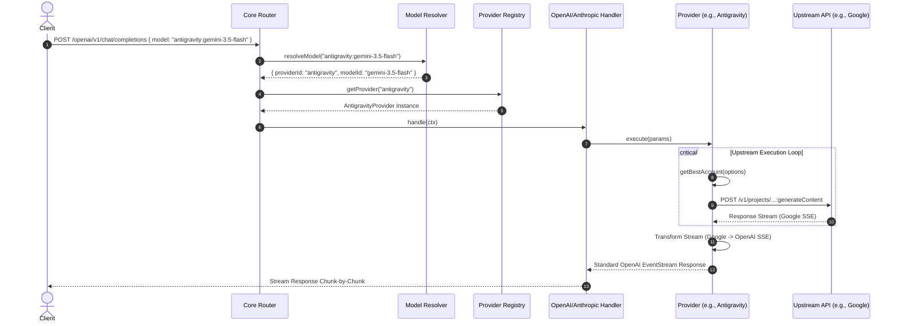
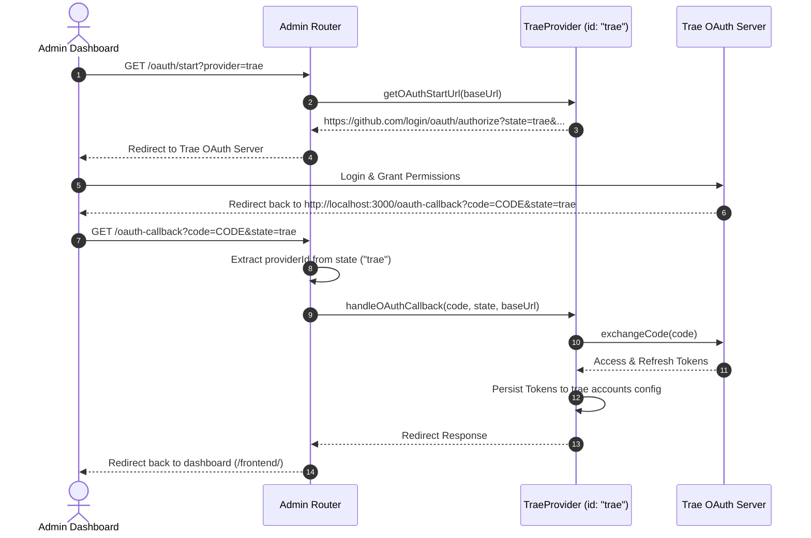

# Provider-Agnostic Proxy Gateway Architecture

This document describes the architectural layout, core design patterns, and request execution pipelines of the proxy gateway. The system is designed to be **100% provider-agnostic**, decoupling the client-facing APIs (OpenAI/Anthropic protocols) from the upstream service providers (`antigravity`, `trae`, `cursor`, etc.).

---

## 1. High-Level Architecture Overview

The gateway is split into two primary planes:
1. **Data Plane**: Handles runtime API request translation, model resolution, upstream account rotation, and response/SSE streaming.
2. **Control Plane**: Handles administrative tasks, dashboard interfaces, logging, configuration management, and account status sync.



---

## 2. Core Decoupling Patterns

The core architecture isolates all provider-specific implementations from the framework engine using three abstractions:

### A. The `IProvider` Interface
Every upstream service provider implements the `IProvider` interface (defined in [src/core/interfaces.ts](file:///Users/gadingnst/Workspace/nouverse/antigravity-proxy/apps/backend/src/core/interfaces.ts)).

```typescript
export interface IProvider {
  readonly id: string;
  readonly displayName: string;

  init(): Promise<void>;
  getBestAccount(options: AccountRequestOptions): Promise<IAccount | null>;
  updateAccountUsage(accountId: string, success: boolean, meta: any): Promise<void>;
  getAccounts(): IAccount[];
  getModelRegistry(): IModelRegistry;
  getSupportedModels(): string[];
  execute(params: ProviderExecuteParams): Promise<Response>;

  // Optional Administrative Methods
  getStrategy?(): string;
  setStrategy?(strategy: string): Promise<void>;
  getConfig?(): any;
  updateConfig?(updates: any): Promise<any>;
  resetAllAccounts?(): Promise<void>;
  removeAccount?(accountId: string): Promise<void>;
  resetAccount?(accountId: string): Promise<void>;
  updateAccountProject?(accountId: string, projectId: string): Promise<void>;
  rediscoverAccountProject?(accountId: string): Promise<any>;
  markAccountCooldown?(accountId: string, pool: string, duration?: string): Promise<void>;
  getCooldowns?(): Record<string, number>;
  addAccount?(body: any): Promise<any>;
}
```

### B. Provider Prefix Resolution (`provider:model`)
Model identifiers sent by the client must follow the format `"providerId:modelId"` (e.g. `antigravity:gemini-3.5-flash`). 
The [Model Resolver](file:///Users/gadingnst/Workspace/nouverse/antigravity-proxy/apps/backend/src/core/model-resolver.ts) parses this string at runtime to select the active provider. If no provider prefix is supplied, it falls back to the default registered provider.

### C. Core Event Bus (`adminEventBus`)
To prevent the logging middleware and admin router from depending directly on any particular provider's internal state, a centralized event emitter is hosted at [src/core/events.ts](file:///Users/gadingnst/Workspace/nouverse/antigravity-proxy/apps/backend/src/core/events.ts). Providers emit their cooldown changes, selection updates, and status flashes to this bus, which the Admin SSE stream captures and forwards to the dashboard.

---

## 3. Sequence Diagrams

### A. Chat Completion Request Pipeline
This diagram illustrates the lifecycle of a request from ingress to egress through the decoupled core.



### B. Multi-Provider Conflict-Free OAuth Flow
When multiple providers require OAuth token acquisition, they utilize the standard OAuth `state` parameter to route callbacks dynamically without path collisions.



---

## 4. How to Implement a New Provider (e.g., `trae` or `cursor`)

To add a new provider, follow these steps:

1. **Create the Provider Folder**:
   Create a new directory `apps/backend/src/providers/trae/`.

2. **Implement `IProvider`**:
   Write `index.ts` inside that folder implementing the class:
   ```typescript
   import type { IProvider, IAccount, IModelRegistry, ProviderExecuteParams } from '@/core/interfaces';

   export class TraeProvider implements IProvider {
     readonly id = 'trae';
     readonly displayName = 'Trae';

     async init(): Promise<void> {
       // Initialize local configuration and accounts
     }

     async getBestAccount(options: any): Promise<IAccount | null> {
       // Perform local rotation and cooldown scoring
     }

     async updateAccountUsage(accountId: string, success: boolean, meta: any): Promise<void> {
       // Handle penalty/reward scoring on usage
     }

     getAccounts(): IAccount[] {
       // Return current active accounts list
     }

     getModelRegistry(): IModelRegistry {
       // Return provider-scoped models
     }

     getSupportedModels(): string[] {
       return ['trae-gpt-4o', 'trae-claude-3.5-sonnet'];
     }

     async execute(params: ProviderExecuteParams): Promise<Response> {
       // Map inbound payload to Trae backend format, execute, and stream response back
     }
   }
   ```

3. **Register the Provider**:
   Import and register the provider inside [src/server.ts](file:///Users/gadingnst/Workspace/nouverse/antigravity-proxy/apps/backend/src/server.ts):
   ```typescript
   import { TraeProvider } from "@/providers/trae";
   
   const traeProvider = new TraeProvider();
   await traeProvider.init();
   registerProvider(traeProvider);
   ```

4. **Verify**:
   Run `bun test` to verify no regressions occurred in existing routing systems. Clients can now query using the prefix `trae:trae-gpt-4o`.
