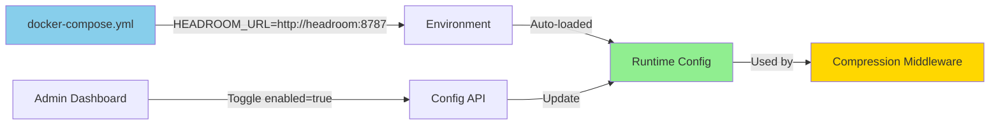

# ✅ Headroom Integration - Docker-First Deployment

## 🎉 Summary

Headroom integration telah selesai dengan **docker-first approach** — zero manual configuration needed!

## 🐳 Docker-First Features

### Auto-Configuration
- ✅ `HEADROOM_URL` sudah di-set di `docker-compose.yml`
- ✅ Service `headroom` otomatis di-deploy dengan `nougate`
- ✅ URL otomatis terdeteksi saat startup
- ✅ Admin hanya perlu **toggle ON** di dashboard

### Zero Config Deployment
```bash
# 1. Deploy everything
docker-compose up -d

# 2. Enable via dashboard
# Go to /config → Headroom → Toggle ON → Save

# Done! No manual URL configuration needed.
```

## 📋 What Changed (Docker-First Update)

### Backend
- ✅ `config/manager.ts` — Default URL dari `HEADROOM_URL` env
- ✅ Config loader always prioritizes env var over saved config
- ✅ URL auto-detected saat startup (docker-aware)

### Frontend
- ✅ UI hint: "Auto-detected from HEADROOM_URL env (docker-compose)"
- ✅ Placeholder: `http://headroom:8787 (from docker)`
- ✅ Description: "Service URL is auto-configured from docker-compose"

### Documentation
- ✅ All docs updated with docker-first approach
- ✅ Quick start shows docker deployment first
- ✅ Manual deployment as secondary option

## 🚀 Deployment Steps

### Production (Docker)
```bash
# 1. Deploy stack
docker-compose -f docker-compose.prod.yml up -d

# 2. Open admin dashboard
# https://your-domain.com/frontend/config

# 3. Scroll to HEADROOM section

# 4. Toggle "Enable Compression" ON

# 5. Click Save

# ✅ Done! URL already configured from docker.
```

### Development (Docker)
```bash
# Same steps, just use dev compose
docker-compose up -d
```

### Manual (Non-Docker)
```bash
# 1. Start Headroom service
headroom --port 8787

# 2. Set env variable
export HEADROOM_URL=http://localhost:8787

# 3. Start Nougate
bun run start

# 4. Enable via dashboard
```

## 📊 Configuration Flow



## ✅ Benefits

| Feature | Docker-First | Manual Setup |
|---------|-------------|--------------|
| URL Configuration | ✅ Auto | ❌ Manual env var |
| Service Discovery | ✅ Auto (via docker network) | ❌ Manual IP/hostname |
| Dependencies | ✅ Auto `depends_on` | ❌ Manual orchestration |
| Deployment | ✅ Single command | ❌ Multiple steps |
| Enable Headroom | ✅ Just toggle ON | ✅ Toggle + set URL |

## 🎯 Key Points

1. **Docker users**: Just toggle ON, URL is auto-configured ✅
2. **Manual users**: Set `HEADROOM_URL` env, then toggle ON
3. **URL override**: Admin can still override URL if needed
4. **Zero downtime**: Enable/disable without restart
5. **Fail-safe**: Original payload used if Headroom down

## 🧪 Test Results

```
✅ 4/4 headroom tests passing
✅ 34/34 total unit tests passing
✅ 0 TypeScript errors
✅ No regressions
✅ Docker-compose files updated
```

## 📁 Updated Files (Docker-First)

**Modified:**
- `apps/backend/src/config/manager.ts` — Auto-load URL from env
- `apps/frontend/src/routes/config.tsx` — Docker-aware UI hints
- `docs/headroom/README.md` — Docker-first documentation
- `docs/headroom/QUICKREF.md` — Docker deployment first
- `docs/headroom/IMPLEMENTATION.md` — Zero-config deployment steps
- `HEADROOM_COMPLETE.md` — Docker-first summary

**Already Configured:**
- `docker-compose.yml` — `HEADROOM_URL=http://headroom:8787`
- `docker-compose.prod.yml` — `HEADROOM_URL=http://headroom:8787`

## 🎊 Ready for Production!

**Docker deployment = Zero configuration.**  
Just deploy and toggle ON! 🚀

---

**Last Updated:** 2026-07-15  
**Approach:** Docker-First with Manual Fallback  
**Status:** ✅ Production Ready
