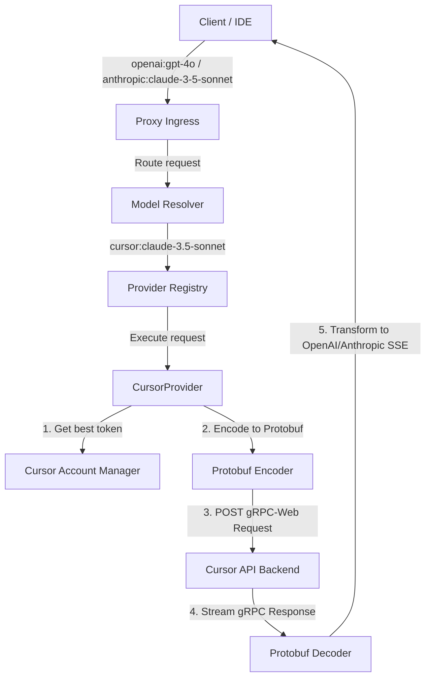

# Implementation Plan: Cursor.ai Upstream Provider (`CursorProvider`)

Dokumen ini menjelaskan rencana implementasi untuk mengintegrasikan **Cursor.ai** sebagai upstream provider di `antigravity-proxy` menggunakan pendekatan **semi-manual account farming**.

---

## 1. Konsep & Arsitektur

Cursor akan didaftarkan sebagai provider dengan ID `cursor`. Pengguna dapat memasukkan token autentikasi Cursor secara manual melalui Dashboard Control Plane, lalu proxy akan merotasi token-token tersebut dan menerjemahkan request client (OpenAI/Anthropic) ke format API internal Cursor.



---

## 2. Struktur Data & Interface

Kita akan mengimplementasikan interface [IProvider](apps/backend/src/core/interfaces.ts) untuk kelas `CursorProvider`.

### A. Interface Akun (`CursorAccount`)
```typescript
import type { IAccount } from '@/core/interfaces';

export interface CursorAccount extends IAccount {
  readonly providerId: 'cursor';
  readonly token: string;        // WorkosCursorSessionToken cookie value
  readonly email: string;        // Terbaca dari JWT/Metadata untuk identifikasi
  status: 'active' | 'cooldown' | 'invalid';
  coolDownUntil?: number;
}
```

### B. Kelas Utama `CursorProvider`
Kelas ini akan ditempatkan di `apps/backend/src/providers/cursor/index.ts`.

```typescript
import type { IProvider, IAccount, IModelRegistry, ProviderExecuteParams } from '@/core/interfaces';

export class CursorProvider implements IProvider {
  readonly id = 'cursor';
  readonly displayName = 'Cursor.ai';

  async init(): Promise<void> {
    // Load config dan accounts dari database/config file lokal
  }

  async getBestAccount(options: any): Promise<IAccount | null> {
    // Memilih token aktif dengan health score terbaik
  }

  async updateAccountUsage(accountId: string, success: boolean, meta: any): Promise<void> {
    // Menurunkan score atau memicu cooldown jika limit 50 premium requests tercapai
  }

  getAccounts(): IAccount[] {
    // Mengembalikan list akun/token Cursor
  }

  getModelRegistry(): IModelRegistry {
    // Model yang didukung: ['cursor-gpt-4o', 'cursor-claude-3.5-sonnet']
  }

  getSupportedModels(): string[] {
    return ['cursor-gpt-4o', 'cursor-claude-3.5-sonnet'];
  }

  async execute(params: ProviderExecuteParams): Promise<Response> {
    // Main routing logic: JSON -> Protobuf -> Fetch -> Decode Protobuf -> SSE Stream
  }
}
```

---

## 3. Detail Protokol API & Protobuf Spoofing

API Chat Cursor menggunakan **gRPC-web/Protobuf** di atas HTTP/2.

### A. Endpoint Utama
*   **Chat Stream**: `https://api.cursor.sh/api.v1.CursorService/StreamChat`
*   **Headers Utama**:
    *   `Authorization: Bearer <WorkosCursorSessionToken>`
    *   `Content-Type: application/grpc-web+proto`
    *   `x-cursor-client-version`: `0.45.8` (atau versi terbaru)
    *   `x-cursor-checksum`: Checksum gabungan UUID mesin untuk memvalidasi keaslian aplikasi client.

### B. Struktur Pesan Protobuf
Kita perlu mendefinisikan skema protobuf minimal untuk request chat completion. Skema ini dapat direferensikan dari repositori reverse engineering seperti `vibe-coding-labs/trae-reverse-engineering` atau parser gRPC-web node.
```protobuf
message StreamChatRequest {
  repeated Message messages = 1;
  string model = 2;
  string summary = 3;
  // ... parameter tambahan seperti tools dan context
}
```
*Di dalam project Bun, kita bisa memanfaatkan library `@bufbuild/protobuf` atau parser binary manual jika ingin menghindari dependensi compiler protobuf eksternal.*

---

## 4. Rencana Tahapan Implementasi (Phases)

### **Phase 1: R&D & Protobuf Decoder (Hari 1-2)**
*   Menganalisis payload request & response dari Cursor IDE asli menggunakan interceptor (Proxyman/Charles).
*   Menulis modul parser binary/Protobuf sederhana di `apps/backend/src/providers/cursor/utils/protobuf.ts` untuk mengonversi JSON message thread ke binary format gRPC-web, dan sebaliknya (untuk streaming response).

### **Phase 2: Pengembangan `CursorProvider` (Hari 3)**
*   Membuat file `index.ts` di `apps/backend/src/providers/cursor/`.
*   Mengimplementasikan rotasi akun, tracking limit penggunaan (jika mendeteksi HTTP 429 atau status premium habis), dan konversi error.

### **Phase 3: Integrasi Control Plane & Dashboard UI (Hari 4)**
*   Menambahkan rute admin di `apps/backend/src/router/admin.ts` untuk menambahkan token Cursor: `POST /api/admin/providers/cursor/accounts`.
*   Memperbarui UI Dashboard Frontend di `apps/frontend/` untuk menampilkan daftar akun Cursor, status keaktifan, dan form untuk memasukkan cookie `WorkosCursorSessionToken`.

### **Phase 4: Uji Coba & Kalibrasi (Hari 5)**
*   Menjalankan test suite menggunakan client tiruan (Zed atau Continue).
*   Memvalidasi stream output dan memastikan *cooldown* otomatis berfungsi ketika salah satu akun terkena limit.

---

## 5. Rencana Verifikasi

### Uji Coba Otomatis
*   Menulis unit test di `apps/backend/tests/unit/cursor.test.ts` untuk memverifikasi modul encoding/decoding Protobuf.

### Uji Coba Manual
1. Daftarkan akun baru di web Cursor, ambil token `WorkosCursorSessionToken`.
2. Input token tersebut di dashboard proxy baru.
3. Kirim request chat completions menggunakan client Curl / Bruno:
   ```bash
   curl http://localhost:3000/openai/v1/chat/completions \
     -H "Content-Type: application/json" \
     -d '{
       "model": "cursor:cursor-claude-3.5-sonnet",
       "messages": [{"role": "user", "content": "Hello!"}]
     }'
   ```
4. Pastikan respons yang kembali berupa format standard OpenAI.
