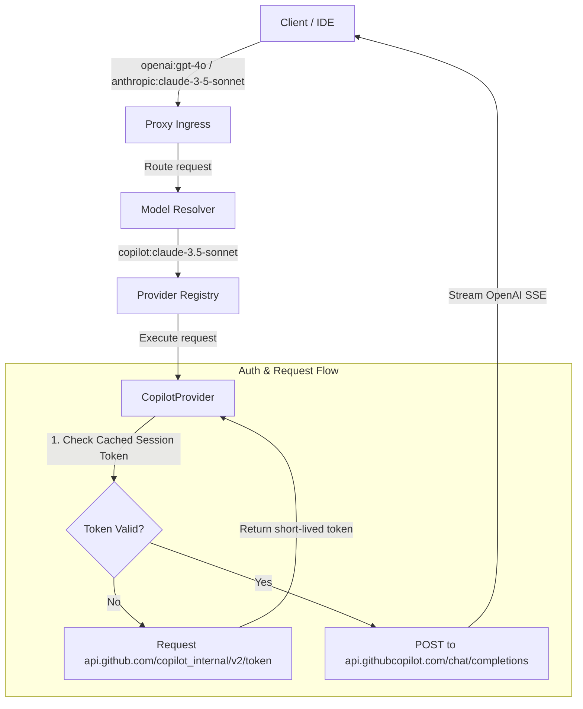

# Implementation Plan: GitHub Copilot Upstream Provider (`CopilotProvider`)

Dokumen ini menjelaskan rencana implementasi untuk mengintegrasikan **GitHub Copilot** sebagai upstream provider di `antigravity-proxy`.

---

## 1. Konsep & Arsitektur

GitHub Copilot akan didaftarkan sebagai provider dengan ID `copilot`. Karena Copilot menggunakan protokol yang kompatibel dengan OpenAI API pada backend-nya (`api.githubcopilot.com`), proses translasi request-nya sangat sederhana. 

Tantangan utama pada provider ini adalah menangani **Token Exchange** dari token personal jangka panjang (*long-lived personal token*) menjadi token sesi jangka pendek (*short-lived session token*).



---

## 2. Struktur Data & Interface

Kita akan mengimplementasikan interface [IProvider](apps/backend/src/core/interfaces.ts) untuk kelas `CopilotProvider`.

### A. Interface Akun (`CopilotAccount`)
```typescript
import type { IAccount } from '@/core/interfaces';

export interface CopilotAccount extends IAccount {
  readonly providerId: 'copilot';
  readonly personalToken: string;       // Token ghu_... atau gho_... dari hosts.json
  sessionToken?: string;                // Token sesi jangka pendek hasil exchange
  sessionTokenExpiresAt?: number;       // Epoch timestamp kadaluarsa token sesi
  status: 'active' | 'cooldown' | 'invalid';
}
```

### B. Kelas Utama `CopilotProvider`
Kelas ini akan ditempatkan di `apps/backend/src/providers/copilot/index.ts`.

```typescript
import type { IProvider, IAccount, IModelRegistry, ProviderExecuteParams } from '@/core/interfaces';

export class CopilotProvider implements IProvider {
  readonly id = 'copilot';
  readonly displayName = 'GitHub Copilot';

  async init(): Promise<void> {
    // Load config dan accounts dari database/config file lokal
  }

  async getBestAccount(options: any): Promise<IAccount | null> {
    // Memilih akun Copilot aktif, melakukan pertukaran token sesi jika kadaluarsa
  }

  async updateAccountUsage(accountId: string, success: boolean, meta: any): Promise<void> {
    // Penanganan error / cooldown jika token invalid atau terkena rate limit
  }

  getAccounts(): IAccount[] {
    // Mengembalikan list akun/token Copilot
  }

  getModelRegistry(): IModelRegistry {
    // Model yang didukung: ['copilot-gpt-4o', 'copilot-claude-3.5-sonnet', 'copilot-gemini-1.5-pro']
  }

  getSupportedModels(): string[] {
    return ['copilot-gpt-4o', 'copilot-claude-3.5-sonnet', 'copilot-gemini-1.5-pro'];
  }

  async execute(params: ProviderExecuteParams): Promise<Response> {
    // Memanggil API GitHub Copilot chat completions
  }
}
```

---

## 3. Detail Protokol API & Token Exchange

### A. Alur Pertukaran Token Sesi (Token Exchange)
Token personal jangka panjang (berawalan `ghu_` atau `gho_`) tidak bisa langsung dipakai untuk chat. Kita harus menukarkannya terlebih dahulu:
1.  **Endpoint**: `https://api.github.com/copilot_internal/v2/token`
2.  **Headers**:
    *   `Authorization: Bearer <personalToken>`
    *   `User-Agent: GithubCopilot/1.250.0`
3.  **Response**:
    ```json
    {
      "token": "tid=...;exp=1719999999;...", // Token sesi jangka pendek
      "expires_at": 1719999999,
      "refresh_in": 1500
    }
    ```
    *Kita harus men-cache token sesi ini dan me-refresh-nya sebelum waktu kadaluarsa (biasanya berlaku selama 25-30 menit).*

### B. Request Chat Completions
1.  **Endpoint**: `https://api.githubcopilot.com/chat/completions`
2.  **Headers**:
    *   `Authorization: Bearer <sessionToken>`
    *   `Editor-Version: vscode/1.90.0`
    *   `User-Agent: GitHubCopilot/1.250.0`
3.  **Payload (JSON)**: Sama dengan skema standar OpenAI chat completions.

---

## 4. Rencana Tahapan Implementasi (Phases)

### **Phase 1: Implementasi Modul Autentikasi (Hari 1)**
*   Membuat file pembantu `apps/backend/src/providers/copilot/utils/auth.ts` untuk menangani pertukaran token sesi dari `api.github.com`.
*   Menulis fungsi pengecekan kadaluarsa token dan auto-refresh.

### **Phase 2: Pengembangan `CopilotProvider` (Hari 2)**
*   Membuat kelas `CopilotProvider` di `apps/backend/src/providers/copilot/index.ts`.
*   Mengintegrasikan modul autentikasi dengan sistem pemilihan akun terbaik (`getBestAccount`).
*   Mengimplementasikan fungsi `execute()` yang meneruskan payload JSON ke `api.githubcopilot.com` dan memancarkan stream OpenAI SSE kembali ke client.

### **Phase 3: Integrasi Dashboard UI & Model Config (Hari 3)**
*   Menambahkan rute pendaftaran token Copilot di Admin Router.
*   Memperbarui UI Dashboard Frontend agar admin dapat memasukkan token `ghu_` / `gho_` secara manual atau membaca otomatis dari path default `~/.config/github-copilot/hosts.json` jika dijalankan di mesin lokal (bukan Docker).

### **Phase 4: Uji Coba & Kalibrasi (Hari 4)**
*   Menulis unit test di `apps/backend/tests/unit/copilot.test.ts`.
*   Verifikasi streaming chat completions dengan berbagai model pendukung (GPT-4o, Claude 3.5 Sonnet, Gemini 1.5 Pro).

---

## 5. Rencana Verifikasi

### Uji Coba Manual
1. Jalankan server proxy lokal.
2. Ambil token Copilot Anda dari `~/.config/github-copilot/hosts.json`.
3. Daftarkan token tersebut ke dashboard admin.
4. Kirim request pengujian:
   ```bash
   curl http://localhost:3000/openai/v1/chat/completions \
     -H "Content-Type: application/json" \
     -d '{
       "model": "copilot:copilot-claude-3.5-sonnet",
       "messages": [{"role": "user", "content": "Hello Copilot!"}]
     }'
   ```
5. Pastikan stream output berjalan lancar dan token sesi ter-cache dengan benar di backend logs.
