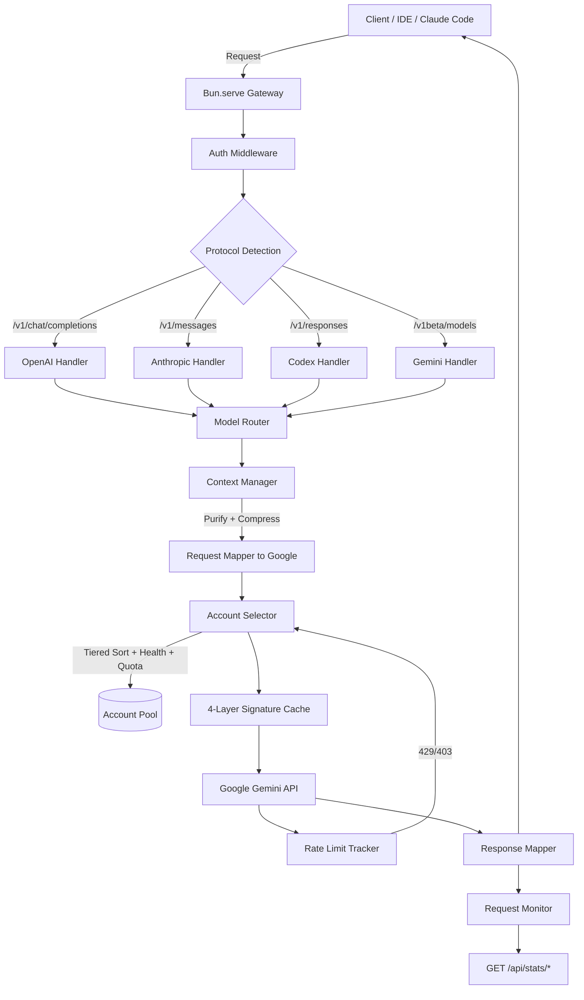

# Antigravity Proxy — Revamp Plan

Dokumen ini merangkum fitur-fitur inti dari [Antigravity-Manager](https://github.com/lbjlaq/Antigravity-Manager) (Rust/Axum, 30k★) yang relevan dan layak diadopsi ke proxy kita (Bun/TypeScript), beserta prioritas dan estimasi kompleksitas.

> [!NOTE]
> Semua fitur di bawah dipilih berdasarkan **analisis langsung** terhadap source code `src-tauri/src/proxy/` dari Antigravity-Manager v4.3.0. Source code referensi tersedia di `tmp/antigravity-manager/`. Fitur yang hanya relevan untuk desktop app (Tauri GUI, IDE account switching, dll.) **tidak** dimasukkan.

> [!TIP]
> Prefix path `REF:` di bawah merujuk ke `tmp/antigravity-manager/src-tauri/src/proxy/` relatif dari root project kita.

---

## 1. Gap Analysis: Kita vs Antigravity-Manager

| Fitur | Proxy Kita | Antigravity-Manager | Priority |
|-------|:----------:|:-------------------:|:--------:|
| OpenAI-compatible endpoint | ✅ | ✅ | — |
| Anthropic native `/v1/messages` | ❌ | ✅ | 🔴 High |
| Gemini native endpoint | ❌ | ✅ | 🟡 Medium |
| Codex `/v1/responses` endpoint | ❌ | ✅ | 🟡 Medium |
| Multi-layer signature cache | 🟡 Basic (2-layer) | ✅ (4-layer: tool, family, session, reasoning) | 🔴 High |
| Tiered account sorting (Ultra/Pro/Free) | ❌ | ✅ | 🔴 High |
| Model-level rate limiting | ❌ (account-level only) | ✅ (account + model level) | 🔴 High |
| Rate limit tracker with exponential backoff | 🟡 Basic cooldown | ✅ (per-account failure counter + backoff) | 🔴 High |
| Model routing / regex mapping | ❌ (hardcoded) | ✅ (dynamic, configurable) | 🟡 Medium |
| Background task silent downgrade | ❌ | ✅ (reroute ke Flash) | 🟡 Medium |
| Tool result compression | ❌ | ✅ (browser snapshot, HTML cleanup) | 🟡 Medium |
| Context purification (thinking strip) | 🟡 Basic | ✅ (soft/aggressive + token estimation) | 🟡 Medium |
| Request monitoring / usage logging | ❌ | ✅ (SQLite + real-time stats) | 🟡 Medium |
| `/v1/models` endpoint | ❌ | ✅ | 🟢 Low |
| `/v1/images/generations` (Imagen 3) | ❌ | ✅ | 🟢 Low |
| API Key auth middleware (multi-token) | ❌ (single header) | ✅ (per-user tokens + whitelist/blacklist) | 🟢 Low |
| IP filtering / security | ❌ | ✅ (whitelist/blacklist + access logs) | 🟢 Low |
| Account warmup | ❌ | ✅ (pre-flight token validation) | 🟢 Low |
| Proxy pool (outbound HTTP proxy rotation) | ❌ | ✅ | 🟢 Low |
| OAuth browser flow | ❌ | ✅ (callback handler) | 🟢 Low |

---

## 2. Fitur yang Akan Diadopsi (Prioritas Tinggi)

### 2.1 🔴 Native Anthropic Endpoint (`/v1/messages`)

**Mengapa penting:** Claude Code CLI dan banyak tool AI lain menggunakan format Anthropic langsung, bukan OpenAI format. Tanpa ini, user harus selalu menggunakan wrapper/shim.

**Referensi kode:**

| File (REF:) | Ukuran | Fungsi |
|-------------|--------|--------|
| `handlers/claude.rs` | 90KB, 1740 lines | Handler utama |
| `mappers/claude/request.rs` | 132KB, 2089 lines | Anthropic → Google transform |
| `mappers/claude/streaming.rs` | 50KB, 1262 lines | Google → Anthropic SSE transform |
| `mappers/claude/models.rs` | 13KB, 384 lines | Struct definitions |
| `mappers/claude/thinking_utils.rs` | 10KB, 284 lines | Thinking block handling |
| `mappers/claude/utils.rs` | 6.6KB, 182 lines | Helper utilities |

**Key methods:**
```
handlers/claude.rs:
  L249  pub async fn handle_messages()          — Main /v1/messages handler
  L1698 pub async fn handle_list_models()       — GET /v1/models/claude
  L1722 pub async fn handle_count_tokens()      — POST /v1/messages/count_tokens

mappers/claude/request.rs:
  L334  pub fn transform_claude_request_in()    — Convert Claude → Google Gemini body
  L76   pub fn clean_cache_control_from_messages() — Strip cache_control from messages
  L258  pub fn merge_consecutive_messages()     — Merge same-role consecutive messages
  L2067 pub fn clean_thinking_fields_recursive() — Strip thinking from JSON recursively

mappers/claude/streaming.rs:
  L15   pub fn remap_function_call_args()       — Fix tool call arg format
  L177  pub struct SignatureManager             — Per-stream signature tracking
  L202  pub struct StreamingState               — SSE stream state machine
```

**Implementasi di proxy kita:**
```
src/
├── handlers/
│   ├── openai.ts         # /v1/chat/completions (existing logic)
│   └── anthropic.ts      # /v1/messages (NEW)
├── mappers/
│   ├── openai-to-google.ts   # OpenAI → Google transform (existing)
│   └── anthropic-to-google.ts # Anthropic → Google transform (NEW)
```

**Scope:**
- `POST /v1/messages` — streaming & non-streaming
- Transform Anthropic message format → Google Gemini format
- Transform Google response → Anthropic SSE events (`message_start`, `content_block_delta`, `message_stop`)
- Support `system` prompt extraction ke `system_instruction`
- Support `thinking` content blocks (extended thinking)
- Support tool_use / tool_result

---

### 2.2 🔴 Multi-Layer Signature Cache

**Mengapa penting:** Cache signature kita saat ini hanya 2-layer (thought text → signature, call ID → signature). Antigravity-Manager menggunakan **4-layer** yang lebih robust:

| Layer | Key | Value | Fungsi |
|-------|-----|-------|--------|
| 1 | `tool_use_id` | signature | Recover signature saat client strip |
| 2 | `signature` | model family | Cegah cross-model signature contamination |
| 3 | `session_id` | latest signature + msg_count | Cegah cross-session pollution + rewind detection |
| 4 | `session_id` | reasoning text per turn | Cache reasoning untuk re-inject saat retry |

**Referensi kode:**

| File (REF:) | Ukuran | Fungsi |
|-------------|--------|--------|
| `signature_cache.rs` | 17KB, 466 lines | Core 4-layer signature cache |
| `mappers/signature_store.rs` | 3.3KB, 69 lines | Global thread-local signature store |

**Key methods (signature_cache.rs):**
```
L45   pub struct SignatureCache                 — Main struct (4 internal HashMaps)
L79   pub fn global()                          — Global singleton accessor
L6    const SIGNATURE_TTL: Duration = 2 hours  — Cache TTL

--- Layer 1: Tool Signatures ---
L85   pub fn cache_tool_signature(tool_use_id, signature)
L114  pub fn get_tool_signature(tool_use_id) -> Option<String>
L10   const TOOL_CACHE_LIMIT: usize = 500

--- Layer 2: Model Family ---
L130  pub fn cache_thinking_family(signature, family)
L159  pub fn get_signature_family(signature) -> Option<String>
L11   const FAMILY_CACHE_LIMIT: usize = 200

--- Layer 3: Session Signature ---
L181  pub fn cache_session_signature(session_id, signature, message_count)
L253  pub fn get_session_signature(session_id) -> Option<String>
L12   const SESSION_CACHE_LIMIT: usize = 1000
L197  // Rewind detection: if message_count < existing → force update

--- Layer 4: Session Reasoning ---
L272  pub fn cache_session_reasoning(session_id, reasoning, turn_index)
L319  pub fn get_session_reasoning(session_id, turn_index) -> Option<String>
```

**Key methods (signature_store.rs):**
```
L18   pub fn store_thought_signature(sig)      — Store to thread-local
L43   pub fn get_thought_signature()            — Read without consuming
L53   pub fn take_thought_signature()           — Read and consume (take)
L63   pub fn clear_thought_signature()          — Clear thread-local
```

**Key methods (openai/streaming.rs — signature integration):**
```
L12   pub fn store_thought_signature(sig, session_id, message_count)
      — Stores to both SignatureCache (Layer 3) and thread-local signature_store
```

**Yang kita belum punya:**
- Layer 2 (model family tracking) — mencegah pakai signature Claude untuk request Gemini
- Layer 3 (session-based + rewind detection) — deteksi kalau user delete message lalu kirim ulang
- Layer 4 (reasoning text cache per turn) — untuk recovery saat retry

**Implementasi:**
- Tambah `signatureFamilyCache: Map<signature, modelFamily>` di `cache.ts`
- Tambah `sessionSignatureCache: Map<sessionId, { signature, messageCount }>` di `cache.ts`
- Tambah rewind detection logic: jika `messageCount` request baru < cached messageCount → force update signature
- TTL: 2 jam (sama seperti Manager)
- Min signature length validation: 50 chars

---

### 2.3 🔴 Tiered Account Sorting

**Mengapa penting:** Saat ini kita rotasi berdasarkan health score saja. Antigravity-Manager mengurutkan akun dengan **4 level priority**:

```
Priority 0: Subscription Tier (ULTRA > PRO > FREE)
Priority 1: Model-specific quota (higher remaining % = higher priority)
Priority 2: Health score (higher = better)
Priority 3: Reset time (sooner reset = higher priority, konsumsi dulu yang segera refresh)
```

**Referensi kode:**

| File (REF:) | Ukuran | Fungsi |
|-------------|--------|--------|
| `token_manager.rs` | 161KB, 3992 lines | Account pool + tiered sorting |

**Key structs & methods (token_manager.rs):**
```
--- Account struct ---
L20   pub struct ProxyToken {
L22       pub access_token: String,
L29       pub subscription_tier: Option<String>,  // "FREE" | "PRO" | "ULTRA"
L30       pub remaining_quota: Option<i32>,
L32       pub health_score: f32,                  // 0.0 - 1.0
L33       pub reset_time: Option<i64>,            // Quota refresh timestamp
L37       pub model_quotas: HashMap<String, i32>, // Per-model quota cache
L38       pub model_limits: HashMap<String, u64>, // Per-model max_output_tokens
      }

--- Sorting logic ---
L1254 tokens_snapshot.sort_by(|a, b| {
L1259     let tier_priority = |tier| {
L1261         if t.contains("ultra") { 0 }        // Priority 0
L1263         else if t.contains("pro") { 1 }
L1265         else if t.contains("free") { 2 }
L1267         else { 3 }
          };
L1272     // Compare tier first
L1280     // Then compare model-specific quota
L1289     // Then compare health_score
      });

--- Token selection ---
L1161 pub async fn get_token(session_id, model, force_rotate) -> Result<ProxyToken>
L128  pub async fn load_accounts() -> Result<usize>
L176  pub async fn reload_account(account_id) -> Result<()>
L855  pub async fn resolve_dynamic_model_for_account() — Per-account model resolution
```

**Implementasi di `manager.ts`:**
- Tambah field `subscriptionTier` ke account config (detected via quota API response field `subscription_tier`)
- Tambah field `modelQuotas: Record<string, number>` per account
- Ubah sorting di `getNextAccount()` dari single-dimension (health) ke multi-dimension
- Akun dengan remaining quota tertinggi untuk model yang diminta diprioritaskan

---

### 2.4 🔴 Model-Level Rate Limiting

**Mengapa penting:** Saat ini rate limit kita hanya per-account. Tapi Google bisa rate-limit per MODEL per account (misal: akun A kena limit untuk `gemini-3-pro` tapi masih bisa untuk `gemini-3-flash`).

**Referensi kode:**

| File (REF:) | Ukuran | Fungsi |
|-------------|--------|--------|
| `rate_limit.rs` | 28KB, 768 lines | Rate limit tracker + exponential backoff |

**Key structs & methods (rate_limit.rs):**
```
--- Enums & Structs ---
L7    pub enum RateLimitReason {
          QuotaExhausted,           // QUOTA_EXHAUSTED
          RateLimitExceeded,        // RATE_LIMIT_EXCEEDED
          ModelCapacityExhausted,   // MODEL_CAPACITY_EXHAUSTED
          ServerError,              // 5xx
          Unknown,
      }
L23   pub struct RateLimitInfo {
L26       pub reset_time: SystemTime,
L28       pub retry_after_sec: u64,
L34       pub reason: RateLimitReason,
L37       pub model: Option<String>,    // None = account-level, Some = model-level
      }
L45   pub struct RateLimitTracker {
L46       limits: DashMap<String, RateLimitInfo>,
L48       failure_counts: DashMap<String, (u32, SystemTime)>,  // For exponential backoff
      }
L42   const FAILURE_COUNT_EXPIRY_SECONDS: u64 = 3600;         // Reset after 1h without failure

--- Key Methods ---
L62   fn get_limit_key(account_id, model) -> String
      — Returns "account_id" or "account_id:model_id"
L71   pub fn get_remaining_wait(account_id, model) -> u64
      — Checks both account-level AND model-level locks
L106  pub fn mark_success(account_id)
      — Resets failure counter on success
L124  pub fn set_lockout_until(account_id, reset_time, retry_after_sec, reason, model)
      — Sets rate limit lock with reason tracking
L203  pub fn parse_from_error(status, headers, body, account_id, model)
      — Parses 429/503 response to extract retry-after, reason, reset time
L575  pub fn get(account_id) -> Option<RateLimitInfo>
L581  pub fn is_rate_limited(account_id, model) -> bool
L600  pub fn cleanup_expired() -> usize
      — Auto-cleanup called every 15s by background task (token_manager.rs L96)
```

**Key methods in token_manager.rs (rate limit integration):**
```
L2212 pub async fn mark_rate_limited(account_id, model, duration, reason)
L2241 pub async fn is_rate_limited(account_id, model) -> bool
L2295 pub fn mark_account_success(account_id)
L2404 pub fn set_precise_lockout(account_id, reset_iso, model, reason)
L2442 pub async fn fetch_and_lock_with_realtime_quota() — Real-time quota check before lock
```

**Retry strategy (handlers/common.rs):**
```
L30   pub fn determine_retry_strategy(status, headers, body) -> Option<RetryStrategy>
L96   pub async fn apply_retry_strategy(strategy, token_manager, account_id)
L167  pub fn should_rotate_account(status_code, strategy) -> bool
      — Returns true for 429, 401, 403, 503, 529
```

**Implementasi:**
- Ubah rate limit key dari `accountId` menjadi `accountId:modelId`
- Track `RateLimitReason`: quota_exhausted vs rate_limit_exceeded vs server_error
- Exponential backoff: failure counter per account dengan auto-reset setelah 1 jam tanpa failure
- Grace window 1500ms untuk transient errors (503/529)

---

## 3. Fitur yang Akan Diadopsi (Prioritas Medium)

### 3.1 🟡 Dynamic Model Routing

**Saat ini:** Model mapping di-hardcode di `transform.ts` (`antigravity-` prefix stripping saja).

**Referensi kode:**

| File (REF:) | Ukuran | Fungsi |
|-------------|--------|--------|
| `mappers/common_utils.rs` | 35KB, 939 lines | Request config resolution + model routing |

**Key methods (common_utils.rs):**
```
L8    pub struct RequestConfig {
L9        pub request_type: String,       // "agent" | "web_search" | "image_gen"
L10       pub inject_google_search: bool,
L13       pub final_model: String,
L16       pub image_config: Option<Value>,
      }
L19   pub fn resolve_request_config(original_model, mapped_model, tools, size, quality, ...)
      — Determines request type, injects google search tool, resolves image config
L367  pub fn inject_google_search_tool(body, mapped_model)
      — Injects googleSearch tool declaration into request body
L434  pub fn detects_networking_tool(tools) -> bool
      — Detects web_search/browser/fetch in tool list
L501  pub fn contains_non_networking_tool(tools) -> bool
```

**Antigravity-Manager punya:**
- Configurable model alias mapping via JSON/GUI
- Regex-based matching
- Background task detection → auto reroute ke Flash model (hemat quota Pro)

**Implementasi:**
```jsonc
// config/model-routes.json
{
  "routes": [
    { "match": "gpt-4.*", "target": "gemini-3-pro-thinking" },
    { "match": "claude-.*-sonnet", "target": "claude-sonnet-4-20250514" },
    { "match": ".*", "target": "gemini-3-flash" }
  ],
  "backgroundPatterns": [
    "generate.*title",
    "summarize",
    "classify"
  ],
  "backgroundTarget": "gemini-3-flash"
}
```

---

### 3.2 🟡 Tool Result Compression

**Mengapa penting:** Client IDE sering mengirim tool results yang sangat besar (file content, browser snapshots 100KB+). Ini bisa menyebabkan "Prompt is too long" error.

**Referensi kode:**

| File (REF:) | Ukuran | Fungsi |
|-------------|--------|--------|
| `mappers/tool_result_compressor.rs` | 13KB, 410 lines | Smart tool result compression |

**Key methods & constants (tool_result_compressor.rs):**
```
--- Constants ---
L13   const MAX_TOOL_RESULT_CHARS: usize = 200_000;       // Max total chars
L16   const SNAPSHOT_DETECTION_THRESHOLD: usize = 20_000;  // Detect browser snapshot
L19   const SNAPSHOT_MAX_CHARS: usize = 16_000;            // Max snapshot output
L22   const SNAPSHOT_HEAD_RATIO: f64 = 0.7;                // Keep 70% head
L26   const SNAPSHOT_TAIL_RATIO: f64 = 0.3;                // Keep 30% tail

--- Methods ---
L34   pub fn compact_tool_result_text(text, max_chars) -> String
      — Main entry: detects content type, applies best compression strategy
      — Strategy 1: Large file notice → extract key info
      — Strategy 2: Browser snapshot → head+tail preservation
      — Strategy 3: Generic → simple truncation
L284  pub fn sanitize_tool_result_blocks(blocks: &mut Vec<Value>)
      — Sanitize tool result content blocks (strip invalid JSON, etc.)
```

**Internal helpers (private fns):**
```
L39-51  — HTML detection + deep_clean_html() pre-processing
L58     — compact_saved_output_notice() for file output patterns
L70     — compact_browser_snapshot() for <html>/<body> content
L80     — Generic truncation fallback
```

**Implementasi:** Tambah `compressToolResult()` di `transform.ts` yang dijalankan sebelum mengirim ke Google API.

---

### 3.3 🟡 Context Purification

**Mengapa penting:** Saat conversation history panjang, thinking blocks dari turn-turn sebelumnya memakan banyak token tanpa value.

**Referensi kode:**

| File (REF:) | Ukuran | Fungsi |
|-------------|--------|--------|
| `mappers/context_manager.rs` | 25KB, 706 lines | Context purification + token estimation |

**Key structs & methods (context_manager.rs):**
```
--- Token Estimation ---
L16   fn estimate_tokens_from_str(s) -> u32
      — ASCII: ~4 chars/token, Unicode/CJK: ~1.5 chars/token + 15% safety margin

--- Purification Strategies ---
L42   pub enum PurificationStrategy {
          Soft,        // Keep last ~2 turns of thinking
          Aggressive,  // Remove ALL thinking blocks
      }

--- Claude Format ---
L58   pub fn purify_history(messages, strategy) -> bool
      — Remove thinking blocks from Claude message history
L110  pub fn estimate_token_usage(request: &ClaudeRequest) -> u32
      — Estimate total tokens (system + messages + tools)
L216  pub fn compress_thinking_preserve_signature(messages) -> bool
      — Compress thinking but keep signatures intact
L284  pub fn extract_last_valid_signature(messages) -> Option<String>
      — Find the last valid signature in history
L325  pub fn trim_tool_messages(messages, keep_last_n_rounds) -> bool
      — Trim old tool call/result pairs

--- OpenAI Format ---
L362  pub fn restore_openai_reasoning_content(messages, session_id)
      — Restore reasoning_content from session cache (Layer 4)
L388  pub fn purify_openai_history(messages, strategy) -> bool
      — Remove reasoning_content from OpenAI messages
L418  pub fn trim_openai_tool_messages(messages, keep_last_n_rounds) -> bool
      — Trim old tool call/result pairs from OpenAI format
```

**Antigravity-Manager strategy:**
- **Soft purification**: Hapus thinking blocks kecuali 2 turn terakhir
- **Aggressive purification**: Hapus SEMUA thinking blocks
- Token estimation: `ASCII / 4 + Unicode / 1.5 + 15% safety margin`

**Implementasi:** Kita sudah partial (strip thinking dari previous turns). Yang perlu ditambah:
- Token estimation function
- Auto-switch ke aggressive mode jika estimated tokens > threshold (misal 900K)
- Log jumlah token yang dihemat

---

### 3.4 🟡 Request Monitoring & Usage Stats

**Mengapa penting:** Saat ini kita tidak punya visibilitas berapa request sukses/gagal, latency, model mana yang paling sering dipakai.

**Referensi kode:**

| File (REF:) | Ukuran | Fungsi |
|-------------|--------|--------|
| `monitor.rs` | 9.6KB, 265 lines | Request logging + stats aggregation |
| `middleware/monitor.rs` | 29KB, ~750 lines | Middleware yang intercept semua request |

**Key structs & methods (monitor.rs):**
```
L8    pub struct ProxyRequestLog {
L10       pub timestamp: i64,
L13       pub status: u16,
L14       pub duration: u64,          // ms
L15       pub model: Option<String>,
L16       pub mapped_model: Option<String>,
L17       pub account_email: Option<String>,
L18       pub client_ip: Option<String>,
L19       pub error: Option<String>,
L22       pub input_tokens: Option<u32>,
L23       pub output_tokens: Option<u32>,
L24       pub protocol: Option<String>, // "openai" | "anthropic" | "gemini"
L25       pub username: Option<String>,
      }
L29   pub struct ProxyStats {
L30       pub total_requests: u64,
L31       pub success_count: u64,
L32       pub error_count: u64,
      }
L35   pub struct ProxyMonitor {
L36       pub logs: RwLock<VecDeque<ProxyRequestLog>>, // Circular buffer
L37       pub stats: RwLock<ProxyStats>,
L38       pub max_logs: usize,
      }
L81   pub async fn log_request(log: ProxyRequestLog)
L192  pub async fn get_logs(limit: usize) -> Vec<ProxyRequestLog>
L213  pub async fn get_stats() -> ProxyStats
L229  pub async fn get_logs_filtered(filter) -> Vec<ProxyRequestLog>
```

**Admin stats endpoints (server.rs):**
```
L554  .route("/stats/summary", get(admin_get_token_stats_summary))
L555  .route("/stats/hourly", get(admin_get_token_stats_hourly))
L556  .route("/stats/daily", get(admin_get_token_stats_daily))
L557  .route("/stats/weekly", get(admin_get_token_stats_weekly))
L558  .route("/stats/accounts", get(admin_get_token_stats_by_account))
L559  .route("/stats/models", get(admin_get_token_stats_by_model))
```

**Implementasi (lightweight, tanpa SQLite):**
- In-memory circular buffer (max 1000 entries)
- `GET /api/stats/summary` → total requests, success rate, avg latency
- `GET /api/stats/models` → breakdown per model
- `GET /api/stats/accounts` → breakdown per account
- Persist ke file setiap 5 menit (opsional)

---

### 3.5 🟡 Codex / Responses Endpoint

**Mengapa penting:** OpenAI Codex CLI menggunakan `POST /v1/responses` yang format-nya berbeda dari `/v1/chat/completions`.

**Referensi kode:**

| File (REF:) | Ukuran | Fungsi |
|-------------|--------|--------|
| `handlers/openai.rs` | 173KB, 4044 lines | OpenAI handler (includes Codex) |
| `mappers/openai/streaming.rs` | 64KB, ~1500 lines | SSE stream builders |

**Key methods:**
```
handlers/openai.rs:
  L28   pub async fn handle_chat_completions()       — /v1/chat/completions handler
  L947  pub async fn handle_completions()             — /v1/completions (legacy) + /v1/responses
  L2079 pub async fn handle_list_models()             — GET /v1/models
  L2245 pub async fn handle_images_generations()      — POST /v1/images/generations
  L3063 pub async fn handle_responses_websocket()     — WebSocket upgrade for /v1/responses
  L3015 pub fn get_cached_tool_call(call_id)          — Codex tool call cache
  L3033 pub fn insert_cached_tool_call(call_id, item) — Cache tool call for Codex

mappers/openai/streaming.rs:
  L72   pub fn create_openai_sse_stream()     — Standard OpenAI SSE stream builder
  L340  pub fn create_legacy_sse_stream()     — Legacy completions SSE
  L462  pub fn create_codex_sse_stream()      — Codex-specific SSE events:
        — response.output_item.added (type: function_call)
        — response.function_call_arguments.delta
        — response.function_call_arguments.done
        — response.output_item.done
        — response.completed

mappers/openai/request.rs:
  L109  pub fn transform_openai_request()    — OpenAI → Google Gemini body transform

mappers/openai/models.rs:                   — OpenAI request/response struct definitions
mappers/openai/collector.rs:                — Response token counting & aggregation
```

**Implementasi:**
- `POST /v1/responses` → transform ke format internal, forward ke Google
- SSE events: `response.output_item.added`, `response.function_call_arguments.delta`, `response.completed`

---

## 4. Fitur Prioritas Rendah (Nice-to-Have)

### 4.1 🟢 `/v1/models` Endpoint

Endpoint list model yang tersedia. Simple static response.

**REF:** `handlers/openai.rs` L2079 `handle_list_models()`

### 4.2 🟢 Imagen 3 Support

`/v1/images/generations` — transform OpenAI image request ke Gemini image model.

**REF:**
- `handlers/openai.rs` L2245 `handle_images_generations()`
- `handlers/openai.rs` L2268 `handle_images_generations_internal()`
- `mappers/common_utils.rs` L153 `parse_image_config()` — parse model suffix (e.g., `-16-9-4k`)
- `mappers/common_utils.rs` L172 `parse_image_config_with_params()` — parse size/quality params

### 4.3 🟢 API Key Auth Middleware (Multi-Token)

Support multiple API keys dengan per-key usage tracking.

**REF:**
- `middleware/auth.rs` L15 `auth_middleware()` — proxy API auth
- `middleware/auth.rs` L24 `admin_auth_middleware()` — admin API auth (stricter)
- `middleware/auth.rs` L242 `pub struct UserTokenIdentity` — token identity struct

### 4.4 🟢 IP Whitelist/Blacklist

Security layer untuk membatasi akses berdasarkan IP.

**REF:** `middleware/ip_filter.rs` (7.6KB)

### 4.5 🟢 Account Warmup

Pre-flight validation: kirim request minimal ke Google saat startup untuk verify token masih valid.

**REF:**
- `handlers/warmup.rs` L44 `handle_warmup()` — POST /internal/warmup
- `server.rs` L684-685 — Per-account and bulk warmup routes

### 4.6 🟢 Outbound Proxy Pool

Rotasi HTTP proxy untuk outbound requests ke Google API (anti-fingerprinting).

**REF:** `proxy_pool.rs` (22KB, 620 lines) — HTTP proxy rotation manager

---

## 5. Arsitektur Target



---

## 6. Struktur File Target

```
src/
├── server.ts                    # Entry point + route registration
├── config/
│   ├── index.ts                 # Proxy config loader
│   └── model-routes.json        # Dynamic model routing rules
├── middleware/
│   ├── auth.ts                  # API key verification
│   ├── cors.ts                  # CORS headers
│   └── monitor.ts               # Request logging middleware
├── handlers/
│   ├── openai.ts                # POST /v1/chat/completions
│   ├── anthropic.ts             # POST /v1/messages
│   ├── codex.ts                 # POST /v1/responses
│   ├── models.ts                # GET /v1/models
│   └── stats.ts                 # GET /api/stats/*
├── mappers/
│   ├── openai-to-google.ts      # OpenAI → Google Gemini transform
│   ├── anthropic-to-google.ts   # Anthropic → Google Gemini transform
│   ├── google-to-openai.ts      # Google → OpenAI SSE transform
│   └── google-to-anthropic.ts   # Google → Anthropic SSE transform
├── core/
│   ├── account-manager.ts       # Account pool, tiered sorting, selection
│   ├── signature-cache.ts       # 4-layer signature cache
│   ├── rate-limiter.ts          # Per-account + per-model rate limiting
│   ├── context-manager.ts       # Thinking purification + tool compression
│   └── model-router.ts          # Dynamic model routing + regex matching
├── auth/
│   └── storage.ts               # OAuth token storage & refresh
└── utils/
    ├── transform.ts             # Shared transform utilities
    ├── cache.ts                  # Generic cache utilities
    └── headers.ts               # Header manipulation
```

---

## 7. Roadmap Implementasi

### Phase 1: Core Robustness (1-2 minggu)
Perkuat fondasi yang sudah ada tanpa mengubah API surface.

- [ ] **4-Layer Signature Cache** — Upgrade `cache.ts` dengan session tracking + rewind detection
- [ ] **Tiered Account Sorting** — Upgrade `manager.ts` dengan multi-dimension sorting
- [ ] **Model-Level Rate Limiting** — Upgrade rate limit dari account-level ke account:model level
- [ ] **Rate Limit Exponential Backoff** — Per-account failure counter + grace window
- [ ] **Tool Result Compression** — Tambah compression layer di `transform.ts`
- [ ] **Context Purification Enhancement** — Token estimation + auto aggressive mode

### Phase 2: Multi-Protocol (2-3 minggu)
Tambah endpoint baru untuk mendukung lebih banyak client.

- [ ] **Refactor ke handler-based architecture** — Pisah `server.ts` ke `handlers/*`
- [ ] **Anthropic `/v1/messages`** — Full Claude Code CLI support
- [ ] **Codex `/v1/responses`** — OpenAI Codex CLI support
- [ ] **`GET /v1/models`** — Model listing endpoint
- [ ] **Dynamic Model Router** — Configurable routing via JSON

### Phase 3: Observability (1 minggu)
- [ ] **Request Monitor** — In-memory request logging
- [ ] **Stats API** — `/api/stats/summary`, `/api/stats/models`, `/api/stats/accounts`
- [ ] **Structured Logging** — Consistent log format dengan request ID tracking

### Phase 4: Security & Polish (1 minggu)
- [ ] **Multi-Token Auth** — Support multiple API keys
- [ ] **IP Filtering** — Whitelist/blacklist
- [ ] **Account Warmup** — Pre-flight validation on startup
- [ ] **Imagen 3 Support** — `/v1/images/generations`

---

## 8. Prinsip Desain

1. **Tetap Lightweight** — Jangan adopt arsitektur desktop app Manager (Tauri, SQLite) ke server proxy kita. Gunakan in-memory + file persistence.
2. **Backward Compatible** — Setiap phase harus tetap backward compatible. `/v1/chat/completions` tidak boleh break.
3. **Incremental** — Setiap item dalam roadmap bisa di-deploy independen.
4. **Test-Driven** — Setiap fitur baru harus punya unit test sebelum merge.
5. **Single Binary** — Tetap bisa di-deploy sebagai single Docker container tanpa external dependencies (no SQLite, no Redis).
