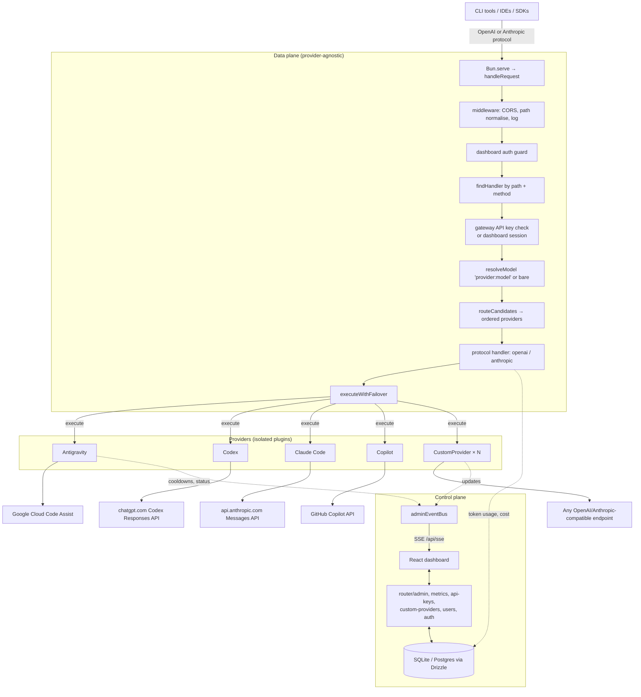
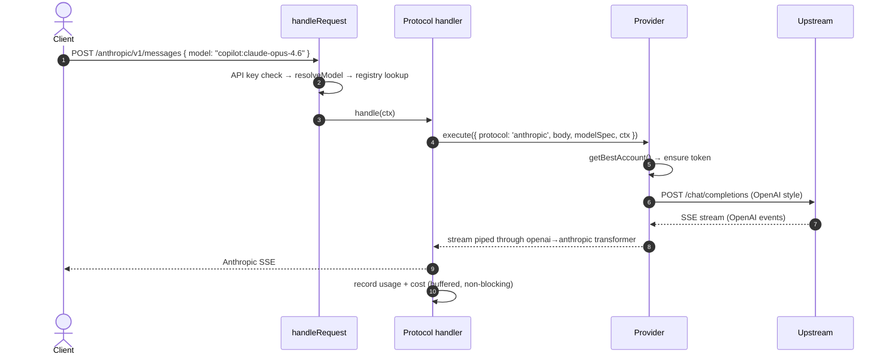

# Nougate Architecture

How the gateway is put together, and why. For task-level guidance when editing it,
see the `nougate-contributing` skill in `../.claude/skills/`.

Nougate is provider-agnostic by construction: the core never knows a provider's name.
Behaviour that differs per provider is expressed as an **optional method on the
`IProvider` contract**, and callers test for the method rather than the id. Adding a
provider is adding a directory; adding a provider *feature* is implementing one more
method.

---

## 1. Planes

**Data plane** — translates client protocol to upstream, resolves the model, picks an
account, streams the response back.

**Control plane** — dashboard, admin API, auth, metrics, SSE event stream.



---

## 2. Request pipeline

`router/index.ts :: handleRequest` is the single entry point. In order:

1. **Normalise + log** the path; answer CORS preflight.
2. **`handleAuthRoute`** — `/api/auth/*` runs first and returns directly, bypassing
   the CORS wrapper so its `Set-Cookie` headers survive intact.
3. **`enforceDashboardAuth`** — everything except the proxy routes, `/oauth/start`,
   `/oauth-callback` and the frontend assets requires a dashboard session. A user
   flagged `mustChangePassword` can reach only `/api/auth/{me,logout,profile}`.
4. **`findHandler(path, method)`** — if a protocol handler claims the path, this is a
   proxy request:
   - **Gateway API key** check — returning a 401 shaped for the protocol the client is
     speaking. A dashboard session plus an `x-nougate-api-key-id` header is accepted in
     its place, which is how the Playground calls the proxy: keys are stored hashed, so
     nothing can hand a signed-in operator the secret back. The session authorises; the
     header only names the key to bill.
   - **Preview body** — the body is cloned and parsed only to read `model`, so
     routing can happen before the handler consumes the stream.
   - **Client id** — `x-client-id` header → `client_id` query → the API key's name →
     `unknown`. A named key therefore gives per-machine cost attribution for free.
   - **`resolveModel`** splits `provider:model`. A prefix is an instruction: it resolves
     to that provider or to nothing. A **bare** model instead fans out — see below.
   - The handler receives a `RequestContext` and returns a `Response`.
5. **`handleAdminRoute`** — admin API, OAuth routes, SSE, and the frontend SPA.
6. Otherwise 404.

### Routing a bare model

`core/smart-routing.ts` answers "who can serve this?" and `executeWithFailover` in
`core/provider-execute.ts` answers "what if they cannot?".

`routeCandidates` returns an ordered list. A prefixed model yields exactly one entry or
none. A bare model yields every provider that **declares** the model and holds at least
one account, in registration order — the sequence in `boot.ts`, which is also the order
the dashboard sidebar shows, so an operator can predict where a request goes.

> Discovery reads `listModelIds()`, never `getSpec()`. A custom provider with
> `bypassModelValidation` answers `getSpec()` for *any* model id, so asking it that way
> gets a yes every time and every bare request lands there regardless of what it serves.

Failover then walks the list. Two rules make it safe:

- **Only before the first byte.** While `executeWithFailover` runs, the handler still
  holds the `Response` and has not returned it, so nothing has reached the client — which
  is what makes discarding a 429 and trying the next provider legitimate even for a
  stream. After it returns, that stops being true. No retry may be added downstream of it.
- **Only failures another provider could fix.** A 400, 413 or 422 is the request being
  wrong, and every provider refuses the identical body — the search stops and the caller
  sees the real reason instead of "all providers failed". A spent quota, dead credentials
  or an unreachable upstream moves on.

Providers disagree about how they give up: most throw, Antigravity returns a 429 with an
`attempts` array. Both are read through the status, because only checking for a throw left
a healthy provider unused while the caller was told the quota was gone.

---

## 3. The contracts

All in `core/interfaces.ts`.

### `IProvider`

```ts
export interface IProvider {
  readonly id: string;            // lowercase; becomes the model prefix
  readonly displayName: string;

  init(): Promise<void>;
  getBestAccount(options: AccountRequestOptions): Promise<IAccount | null>;
  updateAccountUsage(accountId: string, success: boolean, meta): Promise<void>;
  getAccounts(): IAccount[];
  getModelRegistry(): IModelRegistry;
  getSupportedModels(): string[];
  execute(params: ProviderExecuteParams): Promise<Response>;

  // Capabilities — declaring one turns the matching dashboard feature on.
  readonly accountFlow?: 'oauth-redirect' | 'device-code' | 'api-key';
  getQuotas?(): Promise<IProviderQuota[]>;
  getStrategy?(): string;
  setStrategy?(strategy: string): Promise<void>;
  getConfig?(): any;
  updateConfig?(updates: any): Promise<any>;
  addAccount?(body: any): Promise<any>;
  removeAccount?(accountId: string): Promise<void>;
  resetAccount?(accountId: string): Promise<void>;
  resetAllAccounts?(): Promise<void>;
  markAccountCooldown?(accountId: string, pool: string, duration?: string): Promise<void>;
  getCooldowns?(): Record<string, number>;
  handleAccountAction?(accountId: string, action: string, payload?: any): Promise<any>;
}
```

### Capabilities, not names

The rule the whole design rests on. `/api/providers/:id` computes:

```ts
const supportsQuota = typeof p.getQuotas === "function";
return { …, capabilities: { quota: supportsQuota, accountFlow: p.accountFlow ?? null }, quotas };
```

`accountFlow` works the same way and selects which add-account form to render.

The dashboard shows its **Quota** tab from `capabilities.quota` — never from the
provider id, and never from whether data happens to have loaded. Antigravity keeps
the tab while its accounts are still verifying, and shows an explanatory empty state
inside it; Copilot gained the same tab by implementing one method, with zero changes
to the router or the UI.

`IProviderQuota` is the normalised shape every provider reports:

```ts
interface IProviderQuota {
  id: string; label: string; remainingFraction: number;
  unlimited?: boolean; used?: string; limit?: string; unit?: string;
  resetIn?: string; modelIds?: string[];
}
```

Antigravity counts per-model rolling windows and averages them across its account
pool. Copilot counts monthly per-entitlement allowances (chat / completions /
premium interactions) per seat. Neither shape reaches the dashboard — only
`IProviderQuota` does.

### `IProtocolHandler`

```ts
interface IProtocolHandler {
  readonly protocol: ProtocolId;   // 'openai' | 'anthropic' | …
  readonly paths: string[];
  readonly methods: string[];
  handle(ctx: RequestContext): Promise<Response>;
}
```

Registered in `core/registry.ts` the same way providers are, so the router matches
paths without a table of its own.

### Model namespacing

Clients address every model as `provider:model-id`. `core/model-resolver.ts` parses
it; `getModelRegistry().getSpec()` resolves it to an `IModelSpec` carrying
`maxOutputTokens`, thinking mode, pool, timeout and optional per-1M prices. With
`bypassModelValidation` on, an unknown model is passed through and the upstream is
treated as the authority.

---

## 4. Protocol translation

Client protocol and upstream API style are independent, so all four combinations
must work. The shared mappers live in `core/mappers/` and are used by every provider:

| Client | Upstream | Mapper |
|---|---|---|
| Anthropic | OpenAI | `anthropic-to-openai.ts` |
| OpenAI | Anthropic | `openai-to-anthropic.ts` |
| OpenAI | OpenAI | `openai-passthrough.ts` (sanitising only) |
| Anthropic | Anthropic | passthrough with model swap |

A provider whose upstream speaks neither supplies its own mappers under
`providers/<id>/mappers/`. Two do:

- **Antigravity** — Google's Cloud Code Assist protocol.
- **Codex** — OpenAI's *Responses* API, not Chat Completions. `openai-to-responses.ts`
  flattens `messages` into `input` (an assistant turn's `tool_calls` become sibling
  `function_call` items) and turns the Responses event stream back into Chat Completions
  chunks. An Anthropic client reaches it by composition — translated to Chat Completions
  first by the shared mapper, and back last — so there is one Responses translation rather
  than two that would drift.

> A native `/codex/v1/responses` route is still to come: `ProtocolId` already carries
> `'codex'`, and a client that speaks Responses should not be translated to Chat
> Completions and back to reach an upstream that wanted Responses.

Streaming is transformed, never buffered: the upstream `ReadableStream` is piped
through a transformer that rewrites events and extracts usage as bytes pass.



---

## 5. Accounts and rotation

An account is whatever lets a provider make a call: an OAuth identity for Antigravity,
Codex or Claude Code, a GitHub token for Copilot, an API key for a custom provider. All
are `IAccount`, all carry a health score on the same 0–100 scale, cooldowns and a
last-used timestamp, and all render in the same dashboard views.

Selection: drop excluded ids, drop anything still cooling down, then highest health
score with least-recently-used as the tie-break. Strategy (`hybrid`, `sticky`,
`round-robin`, `least-used`, `random`) is global config; scoring weights and
penalties are too, so providers stay comparable.

Failure of one account is not failure of the request — the executor retries with the next
account before surfacing an error, and a bare model then falls through to the next
*provider* as well.

**What a failure is charged to matters.** A 4xx that is not 401 or 429 is the request's
fault: every credential on the same plan refuses the identical body, so it must not cost
the account any health. Getting that wrong took a healthy Codex credential from 100 to 0
in six requests for models the plan did not include, and left a red badge describing a
caller's typo.

---

## 6. Custom providers

`providers/custom/` is a single implementation instantiated many times, once per row
in `custom_providers`. It is the reference for "provider as data":

- The record carries id, display name, base URL, API style (`openai` | `anthropic`),
  extra headers and an enabled flag.
- Keys are accounts, with rotation, health and cooldown.
- Models are rows, optionally auto-discovered from the upstream `/models` endpoint.
  Re-syncing adds new models and never overwrites hand-edited prices.
- `refresh()` re-reads the row, keys and specs into in-memory snapshots, because
  `IProvider`'s getters are synchronous while the store is async.
- Registered **last** in `boot.ts`, so a user-chosen id can never shadow a built-in.

---

## 7. Persistence

Two stores, chosen by what the data is.

**SQLite or Postgres** (Drizzle, selected by `DB_URL`) for anything queried or
aggregated: users, gateway API keys, custom providers and their keys and models,
per-request token usage, daily rollups.

**JSON files** for provider accounts and configs, so they stay inspectable and
hand-editable. Written atomically (temp + rename) and coalesced, because they hold
OAuth refresh tokens.

Everything lives under one directory — `/app/data` in Docker, `./data` locally —
resolved through `core/paths.ts`, never from `process.cwd()`. There are no fallback
locations and no seed copies inside the image.

The two Drizzle schemas (`schema/sqlite.ts`, `schema/pg.ts`) are the same tables
written twice, because Drizzle types tables per dialect. `tests/unit/schema-parity.test.ts`
fails the build if they drift in tables, columns, nullability, defaults or JS types.
Postgres deliberately stores epoch milliseconds as `bigint` and booleans as `0/1`, so
rows round-trip identically and no call site branches on the backend.

---

## 8. Metrics

Every proxied request is recorded: provider, model, protocol, client, gateway API
key, token counts, duration, status, and the tokens compression saved.

- **Non-blocking.** Rows buffer in memory and batch-insert on a timer, so a slow
  database cannot stall an in-flight stream.
- **Real usage where the upstream reports it**, estimated from payload size
  otherwise, and flagged as estimated when so.
- **Compression is attributed per engine.** `prepareRequestPayload` re-measures the
  payload between passes rather than once at each end, so RTK's and Headroom's
  contributions are stored separately as a JSON breakdown on the detail row. The
  parts always sum to the headline total, so the dashboard never shows savings that
  nothing claims. Rollups keep only the combined figure, and the API reports
  `available: false` for those windows instead of an empty split.
- **Cost is resolved, never guessed:** the model's own rate → the built-in price book
  matched on model family → an optional blanket rate (off by default) → otherwise
  **unpriced at $0**, badged in the dashboard. An invented rate is
  indistinguishable from a real one on a chart.
- **Retention:** hourly rollup into daily aggregates, then pruning — in that order, so
  the aggregate exists before its source is dropped. Detail rows are pruned at
  `detailRetentionDays` (14), rollups at `rollupRetentionDays` (90). The read side picks
  its table from the *same* `detailRetentionDays` (`core/metrics/retention.ts`), so the
  two cannot drift into keeping rows nothing reads. Rollups carry the API key, so key
  filtering works across the full 90 days.

---

## 9. Auth

Two independent systems, because the clients are different.

**Dashboard** — username + password in the database, argon2id hashes, stateless
HMAC-signed session cookies. Always on; there is no switch. The signed-in user is
re-read on every request, so deleting an account takes effect immediately.

**Proxy routes** — gateway API keys (`sk-nou-…`), SHA-256 hashed, shown once. Always
required: `/openai/v1/*` and `/anthropic/v1/*` reject unauthenticated requests in the
shape the client's protocol expects, and there is no config that relaxes it. An
instance with no keys serves nobody, which is the safe direction for something
reachable from the internet — "none configured" must never read as "none needed".
Verification is synchronous against an in-memory cache, refreshed on mutation.

CLI clients cannot hold a browser session, which is exactly why the two are separate.

---

## 10. Known gap: browser-redirect OAuth is not yet agnostic

`/oauth/start` and `/oauth-callback` in `router/admin.ts` are hardcoded to
Antigravity — they import `exchangeCode`, `getUserEmail` and `getProjectId` directly
and construct an `AntigravityAccount`. Copilot avoids the issue entirely by using a
device flow through `addAccount()`, which needs no global route.

A second redirect-OAuth provider requires generalising those two routes first:
optional `getOAuthStartUrl(baseUrl, state)` / `handleOAuthCallback(code, baseUrl)` on
`IProvider`, provider id carried in the OAuth `state` parameter (alongside a CSRF
nonce, which the current route lacks), and the Antigravity specifics moved into the
provider. Details in the `nougate-contributing` skill.

Prefer device flow or key-based auth where the upstream offers it.

---

## 11. Adding a provider, in short

1. `apps/backend/src/providers/<id>/` — implement `IProvider`.
2. Credentials via device flow or API keys where possible (see the gap above).
3. Reuse `core/mappers/` unless the upstream speaks something exotic.
4. Provider-local settings in `data/providers/<id>/config.json`, never global config.
5. Optional capabilities — `getQuotas()`, `getConfig()`, `addAccount()` — light up
   dashboard features with no core changes.
6. Register in `boot.ts` before `initCustomProviders()`. Position in that list is display
   order and bare-model routing order; which provider is *default* is decided by id in
   `core/registry`, not by position.
7. Tests under `apps/backend/tests/unit/`.

Clients can then call `<id>:<model>` on either protocol, or the bare `<model>` to let the
gateway choose among every provider that declares it.
