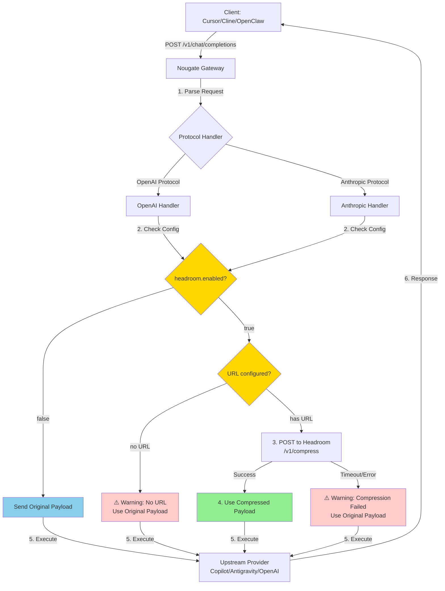
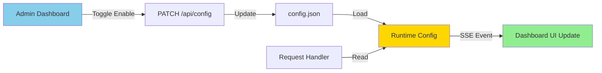
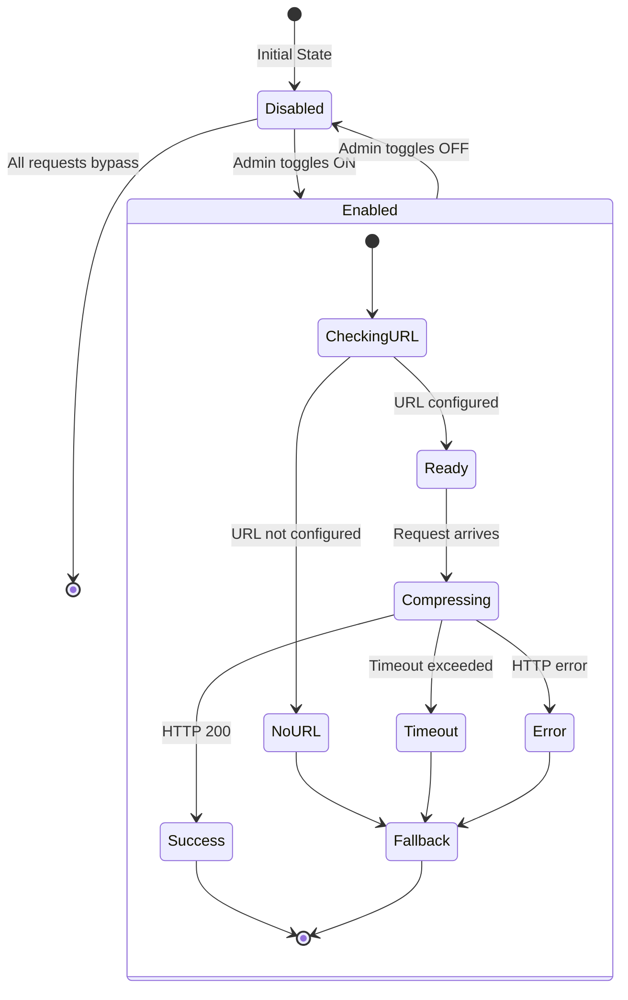
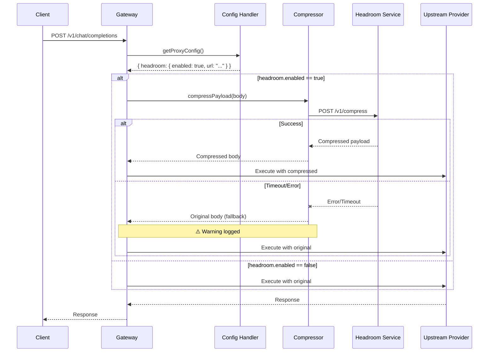

# Headroom Integration Flow

## Architecture Diagram



## Configuration Flow



## Decision Tree

```mermaid
flowchart TD
    Start[Request Received] --> CheckEnabled{headroom.enabled<br/>== true?}
    
    CheckEnabled -->|No| UseOriginal[Use Original Payload]
    CheckEnabled -->|Yes| CheckURL{URL available?<br/>config.url || HEADROOM_URL}
    
    CheckURL -->|No| WarnNoURL[Log Warning<br/>No URL configured] --> UseOriginal
    CheckURL -->|Yes| CallHeadroom[Call Headroom API]
    
    CallHeadroom -->|Success| UseCompressed[Use Compressed Payload]
    CallHeadroom -->|Timeout| WarnTimeout[Log Warning<br/>Timeout occurred] --> UseOriginal
    CallHeadroom -->|Error| WarnError[Log Warning<br/>Compression failed] --> UseOriginal
    
    UseOriginal --> SendUpstream[Send to Upstream]
    UseCompressed --> SendUpstream
    
    SendUpstream --> End[Return Response]
    
    style UseOriginal fill:#87ceeb
    style UseCompressed fill:#90ee90
    style WarnNoURL fill:#ffcccb
    style WarnTimeout fill:#ffcccb
    style WarnError fill:#ffcccb
```

## State Management



## Sequence Diagram


