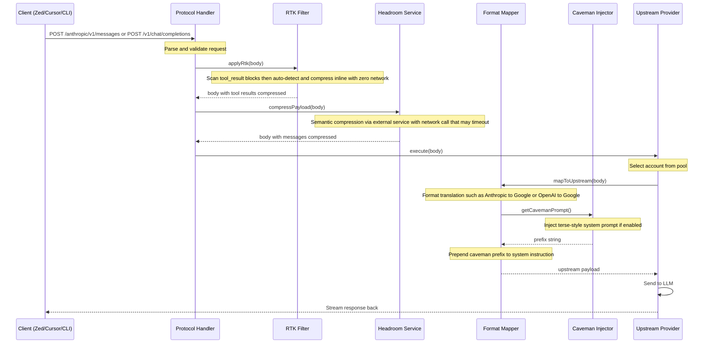
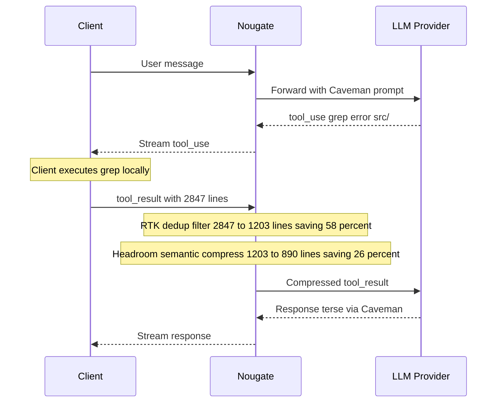
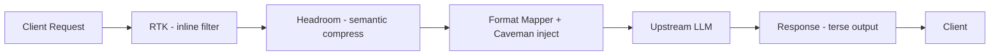

# Token Compression

Nougate has a **3-layer token compression pipeline** that reduces both input and output token usage. Each layer targets a different part of the request/response cycle and can be enabled independently.

```
┌─────────────────────────────────────────────────────────────┐
│                     TOKEN COMPRESSION                       │
│                                                             │
│   Layer 1: RTK          → tool_result content (input)       │
│   Layer 2: Headroom     → full message history (input)      │
│   Layer 3: Caveman      → system prompt injection (output)  │
└─────────────────────────────────────────────────────────────┘
```

---

## Architecture

### Full Request Flow



### Tool Call Flow (with RTK)



### Pipeline Position



---

## Layer 1: RTK (Tool Result Compression)

**Target:** Input tokens — specifically `tool_result` / `tool` message content

**Method:** Pattern-based filters, lossless, inline

**Overhead:** Zero — no network calls, no external dependencies

### How It Works

RTK scans each `tool_result` block (Anthropic format) or `tool` role message (OpenAI format). If the content exceeds 500 characters, it auto-detects the content type and applies the appropriate filter.

### Filters

| Filter | Detects | Compresses By |
|---|---|---|
| **smart-truncate** | Content >50KB | Keep first 20K + last 10K, note truncated count |
| **git-diff** | `diff --git`, `---`, `+++`, `@@` headers | Strip excess context lines (keep 2 instead of 3+) |
| **grep** | Lines matching `path:line:content` pattern | Deduplicate identical result lines |
| **dedup-log** | >30% duplicate lines | Collapse repeated lines with `(xN)` count |
| **ls-tree** | >60% path-like lines, tree chars | Collapse empty lines, deduplicate |

### Safety

- If a filter **fails** (throws), RTK silently keeps the original content
- If a filter makes content **bigger**, RTK keeps the original
- Only processes content **>500 characters** (skip small results)
- Runs **before** any format translation — works on raw client input

### Config

```json
{
  "rtk": {
    "enabled": true
  }
}
```

**Default:** ON — it is safe and lossless.

### Example

```
Without RTK:  47,000 tokens (git diff with 3+ context lines, duplicate grep results)
With RTK:     28,000 tokens (2 context lines, deduped results)
Savings:      ~40%
```

---

## Layer 2: Headroom (Semantic Compression)

**Target:** Input tokens — full message history

**Method:** External AI-powered compression service

**Overhead:** Network call to `headroom:8787` (may timeout)

### How It Works

After RTK pre-filters tool results, the entire payload is sent to the Headroom microservice for semantic compression. Headroom analyzes the full conversation history and compresses it while preserving meaning.

### Adaptive Timeout

The timeout scales with message count to handle larger payloads:

```
Base:  5,000ms (configurable)
Scale: +500ms per message above 5
Cap:   15,000ms

Examples:
  5 messages  → 5,000ms
  11 messages → 8,000ms
  15 messages → 10,000ms
  25 messages → 15,000ms (max)
```

### Small Payload Skip

Payloads with 2 or fewer messages and no tools skip Headroom entirely — not worth the overhead.

### Fail-Safe

If Headroom is down, times out, or returns an error, the original uncompressed payload is used. **Compression failure never breaks the request.**

### Config

```json
{
  "headroom": {
    "enabled": false,
    "url": "http://headroom:8787",
    "timeoutMs": 5000
  }
}
```

**Default:** OFF — requires external Headroom service running.

The `url` is auto-detected from the `HEADROOM_URL` environment variable (docker-compose).

---

## Layer 3: Caveman (Terse Output Mode)

**Target:** Output tokens — LLM response verbosity

**Method:** System prompt injection

**Overhead:** Zero — just a string prepend

### How It Works

Caveman prepends a terse-style instruction to the system prompt before it reaches the LLM. This biases the model toward shorter, more direct responses while preserving technical substance.

The injection happens inside the **format mapper** (Anthropic to Google, OpenAI to Google, Anthropic to OpenAI) so it works across all providers and protocols.

### Intensity Levels

| Level | Style | Example Instruction |
|---|---|---|
| **1** | Mild | Be concise. Avoid filler words. Get to the point. |
| **2** | Moderate | Short sentences. No pleasantries. Technical substance only. |
| **3** | Strong | Telegraphic style. No filler. No preamble. Code speaks louder than words. |
| **4** | Extreme | Bullet points over paragraphs. Skip "here is what I did" — just show the result. |
| **5** | Maximum | No prose. No greetings. Raw output only. Code diff over explanation. |

### Edge Cases

- **No system message:** Caveman creates a new system message/instruction with just the prefix
- **Existing system message:** Caveman prepends to the existing content
- **Disabled:** Returns empty string — zero overhead, no injection

### Config

```json
{
  "caveman": {
    "enabled": false,
    "level": 3
  }
}
```

**Default:** OFF at level 3 — enable when you want to save output tokens.

---

## Recommended Configurations

### Maximum Savings (all layers)

```json
{
  "rtk": { "enabled": true },
  "headroom": { "enabled": true, "url": "http://headroom:8787", "timeoutMs": 5000 },
  "caveman": { "enabled": true, "level": 3 }
}
```

Expected savings: **40-60% input tokens** (RTK + Headroom) + **up to 65% output tokens** (Caveman).

### Safe Default (RTK only)

```json
{
  "rtk": { "enabled": true },
  "headroom": { "enabled": false },
  "caveman": { "enabled": false }
}
```

Expected savings: **20-40% on tool results** with zero risk.

### No Headroom (RTK + Caveman)

```json
{
  "rtk": { "enabled": true },
  "headroom": { "enabled": false },
  "caveman": { "enabled": true, "level": 2 }
}
```

Best for setups without the Headroom Docker service. RTK handles input, Caveman handles output. No external dependencies.

---

## Dashboard

All three layers are configurable from the admin dashboard under **Global Configurations → TOKEN COMPRESSION**:

- **RTK** — green toggle (default ON)
- **Headroom** — blue toggle + service URL + base timeout
- **Caveman** — yellow toggle + intensity level dropdown (1-5)

Changes take effect immediately — no server restart required.
